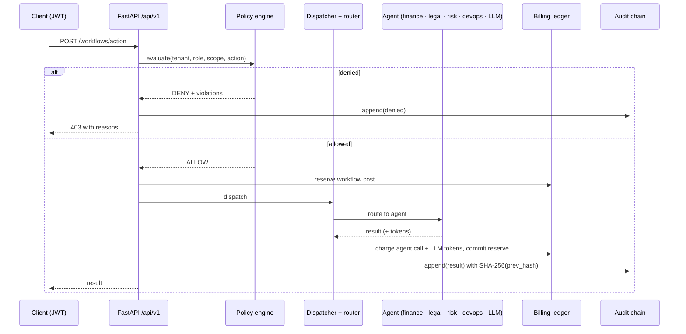

<div align="center">

# 🛡️ B2A Governance Middleware

**A governance layer between businesses and AI agents (B2A). Every agent action is checked against policy, billed and written to a tamper-evident audit chain.**

[](https://fastapi.tiangolo.com/)
[](https://www.sqlalchemy.org/)
[](https://platform.openai.com/)
[](https://prometheus.io/)
[](docker-compose.yml)

[Why](#why) · [How a request flows](#how-a-request-flows) · [Agents](#agents) · [Quick start](#quick-start) · [API](#api)

</div>

---

## Why

Companies are starting to let AI agents act on their behalf: approve a budget, check a contract, ship a deployment.
Before an agent's action is allowed to touch the business, someone has to answer four questions:

1. **Is this agent allowed to do this?** That is the job of the policy engine.
2. **Which agent should handle it?** That is the job of the router and the dispatcher.
3. **What did it cost?** That is the job of the billing ledger.
4. **Can we prove what happened later?** That is the job of the audit chain.

This middleware answers all four for every call, for every tenant.

## How a request flows



## Core pieces

| Module | What it does |
|---|---|
| **Policy engine** (`core/policy_engine.py`) | Per-tenant rules of three kinds (scope, role and action), each returning `allow`, `deny` or `review`. Every violation is collected and returned, so a denial explains itself. |
| **Audit chain** (`core/audit_chain.py`) | Each event stores the SHA-256 of the previous event, so any edit breaks the chain. `GET /audit/verify` re-checks the whole chain and `GET /audit/replay` returns it in order. |
| **Billing engine** (`core/billing_engine.py`) | A double-entry style ledger with per-call agent charges, per-1K-token LLM charges, and workflow costs that are **reserved up front, then committed or voided**. Amounts use `Decimal` for exact money arithmetic. |
| **Agent mesh** (`mesh/`) | A router resolves which agent handles an action, a dispatcher runs single actions or whole workflows, and an in-process message bus publishes events to subscribers. |
| **Workflow engine** (`core/workflow_engine.py`) | Multi-step workflows with state tracked per step. |
| **Identity and security** | JWT auth, bcrypt passwords, role registry, tenant registry, and rate limiting through `slowapi`. |
| **Observability** | Prometheus metrics on `:9090` and structured logs through `structlog`. |

## Agents

| Agent | Domain |
|---|---|
| `budget_agent` | Finance: spend limits and budget checks |
| `compliance_agent` | Legal: compliance review of an action |
| `risk_agent` | Risk scoring |
| `deployment_agent` | DevOps: deployment actions |
| `llm_agent` | General reasoning through the OpenAI API |

All agents extend `BaseAgent` and are registered at startup. Add a new one by subclassing it and registering it in `agents/registry.py`.

## Quick start

**Prerequisites:** Python 3.11+ (or Docker).

```bash
git clone https://github.com/kartikeyajay2006/Multimodel-governance-B2A.git
cd Multimodel-governance-B2A
cp .env.example .env          # set SECRET_KEY, DATABASE_URL, OPENAI_API_KEY
```

**Run locally**

```bash
cd backend
python -m venv .venv && source .venv/bin/activate
pip install -r requirements.txt
uvicorn main:app --reload --port 8000
```

**Or with Docker**

```bash
docker compose up --build backend
```

Optionally load the sample tenants and agents with `python infra/seed_agents.py`.

| URL | |
|---|---|
| `http://localhost:8000/docs` | Swagger UI |
| `http://localhost:8000/health` | Health check |
| `http://localhost:9090` | Prometheus metrics |

SQLite (`sqlite+aiosqlite:///./b2a.db`) works for development. For production, point `DATABASE_URL` at PostgreSQL (`postgresql+asyncpg://...`).

## API

All routes are under `/api/v1`.

| Area | Endpoints |
|---|---|
| Auth | `POST /auth/signup` · `POST /auth/login` · `GET /auth/roles` |
| Agents | `GET /agents` · `POST /agents/register` · `GET DELETE /agents/{agent_id}` |
| Workflows | `POST /workflows/action` · `POST GET /workflows` · `GET /workflows/{id}` · `GET POST /workflows/routes` |
| Policy | `GET POST PUT DELETE /policy/rules` · `POST /policy/evaluate` |
| Billing | `GET /billing/summary` · `/billing/balance` · `/billing/ledger` |
| Audit | `GET /audit/events` · `/audit/verify` · `/audit/replay` |

## Project structure

```text
backend/
  main.py              app factory, lifespan (DB init, metrics, agent registration)
  app/
    api/               auth, agents, workflows, policy, billing, audit routers
    core/              policy engine, audit chain, billing engine, workflow engine, security
    mesh/              router, dispatcher, message bus, workflow state
    agents/            finance, legal, risk, devops, LLM agents
    registry/          tenant, role and agent registries
    models/            SQLAlchemy models
infra/                 init_db.sql, seed data
```

## Author

Built by **[Kartikeya Yadav](https://github.com/kartikeyajay2006)**.
[LinkedIn](https://www.linkedin.com/in/kartikeya2006/) · [Portfolio](https://kartikeya-portfolio-rx7w.vercel.app/)
